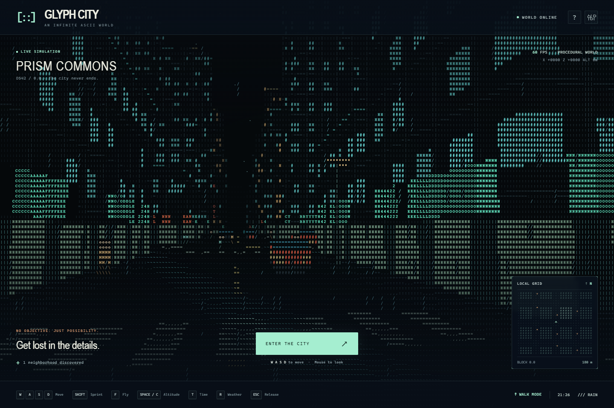

# GLYPH CITY

An explorable 3D city drawn entirely as text glyphs, with procedural neighborhoods, moving traffic and pedestrians, rain, a minimap, and day/night cycles.

Open **index.html** in a current browser. The entire game is in that one file; it works offline and needs no installation, server, account, or external assets. WebGL 2 is required.

Click **Enter the city**, then explore:

| Control | Action |
| --- | --- |
| WASD | Walk or fly horizontally |
| Mouse | Look around (drag if cursor capture is unavailable) |
| Arrow keys / Q and E | Look using the keyboard |
| Shift | Sprint / fast flight |
| F | Toggle flight |
| Space / C | Rise / descend in flight |
| Space while walking | Jump |
| T / R | Change time / weather |
| Escape | Release cursor |
| H or ? | Controls |

Touch devices get movement buttons and swipe-to-look. Standard gamepads use left stick to move, right stick to look, A/left trigger to rise/descend, B to toggle flight, X for weather, Y for time, and Start to enter.

Settings control character density, mouse sensitivity, and automatic day/night and weather cycles. **Return to origin** resets your position. The minimap shows nearby buildings, traffic, and your heading. Exploration counts neighborhoods visited during this session.

The renderer traces procedural buildings, traffic, pedestrians, and streetlights analytically at the character-grid resolution, then draws a monospace glyph atlas in a second GPU pass. No mesh assets, image textures, network calls, or libraries are loaded. Each neighborhood is reproduced deterministically from its coordinates. The world has no authored border; the visible region is regenerated on demand without retaining geometry. Extreme distances are subject to normal floating-point precision limits.

The default density adapts to measured frame rate. Performance varies by GPU; use **Performance** density on slower devices. Browser tab switching suspends simulation, and focus loss clears movement input.

For development, edit the files in `src/`, then run `node tools/build.cjs`. The generated `index.html` remains the only file needed to play.

The source is split into `src/world.js` (procedural layout and movement), `src/renderer.js` (two-pass WebGL glyph rendering), `src/app.js` (controls and instruments), and `src/shell.html` (interface). `design/` contains the visual specification; `screenshots/` contains actual browser captures. The built `index.html` is included intentionally so the game can be opened immediately.

Run the dependency-free movement and procedural-world checks with `node tools/world-smoke.cjs`. Optional browser checks use Playwright: install it locally with `npm install --no-save --package-lock=false playwright`, run `npx playwright install chromium`, then run `node tools/smoke.cjs`. `node tools/perf.cjs` measures warmed-up rendering, and `node tools/capture.cjs` refreshes screenshots. Set `CHROME_PATH` to use an existing browser executable; `PLAYWRIGHT_MODULE_PATH` can point to an existing Playwright installation. These dependencies are for testing only.

No license is granted. The repository is public for viewing; no general permission to copy, modify, or distribute the project is provided.
